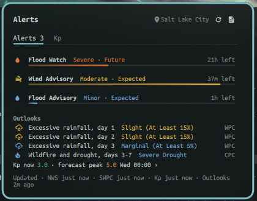

# Weather alerts

A bar widget for the [Omarchy](https://omarchy.org) shell that shows active weather alerts for your location, with a panel for the details.



**What it shows**

- **Active alerts** from the US National Weather Service (watches, warnings and advisories), worst first, each with its severity, how long is left, and the full text and instructions one click away.
- **Geomagnetic storm alerts** from NOAA's Space Weather Prediction Center at G2 (Kp 6) and above, and a Kp chart for the last day and the next three.
- **Outlooks**: the national forecast centres' longer-range hazards for your point, shown as context and never as notifications. See [What the panel shows](#what-the-panel-shows).
- **One desktop notification per new alert**, and another if it escalates or changes.

**Where it works.** The place is Omarchy's weather location. NWS alerts and the outlooks cover the **United States and its territories only**. Anywhere else, the widget still shows storm alerts and Kp, and the panel says that NWS data does not apply. It is not an official warning system, see [Limits](#limits).

## Install

```bash
omarchy plugin add https://github.com/buschbrian/omarchy-weather-alerts.git --enable
```

Plugins install disabled unless you pass `--enable`, so you can read the code first. The widget lands in the right section of the bar; move it with `omarchy bar move buschbrian.weather-alerts --section <left|center|right>`.

You need a place set in Omarchy's weather settings (or search for one in the panel's header). Without one the widget works but only shows storm alerts and Kp.

Update with `omarchy plugin update buschbrian.weather-alerts`. You may need `omarchy restart shell` to load changed QML.

## Remove

```bash
omarchy plugin remove buschbrian.weather-alerts
```

This removes the plugin and its bar entry. It leaves, on purpose:

- `~/.local/state/weather-alerts/`, the alert cache and the list of alerts already notified. Delete the folder if you want it gone.
- Omarchy's weather location, including any place you chose from this widget's search. That setting belongs to Omarchy.

## What the bar shows

| Pill | Meaning |
|---|---|
| A single alert glyph | No active alerts. Click it anyway for outlooks and Kp. |
| One to three glyphs by alert type (tornado, thunderstorm, flood, fire, winter, wind, heat, fog and smoke, geomagnetic storm), then a count if there are more | Active alerts |
| Highlighted | At least one Extreme or Severe alert is active |
| A trailing `?` | A feed failed, or its last good check is over 15 minutes old. Cached alerts that have not expired are still shown. |

Hover for a summary. **Click** opens the panel. **Right click** opens the full text of every active alert in a terminal pager.

## What the panel shows

The header always shows your place (click it to search for another), a fetch-now button, and a full-text button.

**Alerts tab**

- One line per active alert, worst first: severity colour, severity and urgency, time left, and a bar that fills from the alert's start to its end. Click a line for the headline, the area it covers, **What to do** (the NWS instructions) and the full text.
- **Outlooks** that cover your point, one line each, worst first. Hover for the issue and expiry time.
  - SPC: severe storms (days 1–3), mesoscale discussions, fire weather (days 1–2).
  - WPC: excessive rainfall (days 1–3) and winter storm severity.
  - CPC: temperature, precipitation and wildfire/drought hazards (days 3–7 and 8–14).
  - NWS: significant river flooding.
- **Kp now** and the forecast peak. Click it for the Kp tab.
- When each source was last updated, in red if any is stale or failed.

**Kp tab**: observed and predicted planetary Kp in three-hour bars from a day ago to three days ahead, with Kp 6 (G2) marked. Whether you can see aurora also depends on your latitude, darkness, clouds and a clear horizon toward the pole.

An empty state tells you why there is nothing to show: no place set, a place outside the US, or a feed that could not be confirmed. A feed that could not be checked is never reported as "no alerts".

## Notifications

A notification is sent once for each new alert. It is sent again when the alert escalates in severity, when its instructions, area, urgency or certainty change, or when it is extended by 30 minutes or more. Routine reissues of the same alert are suppressed. Extreme and Severe alerts are critical, Moderate alerts and storm alerts are normal, and the rest are low. Clicking a notification opens that alert's full text.

Outlooks never notify. Turn notifications off in the widget's settings; alerts are still listed.

The widget fetches while the shell is running, so notifications stop when the shell does.

## Choosing your place

The widget reads the place from Omarchy's weather settings (`~/.local/state/omarchy/settings/weather.json`). If you change it in Omarchy, the widget follows.

Click the place name in the panel to search. This uses Open-Meteo's geocoder, as Omarchy's weather panel does. Picking a result **changes Omarchy's own weather location** by running `omarchy-weather-location --set`, so Omarchy's weather pill and any other plugin reading it change too. Nothing is written until you pick a result.

Omarchy's own "automatic" location is only a city name found from your IP address, with no coordinates, so it cannot be used to look up alerts. If your weather settings have no place or only a name, the panel shows "Set a place": search for your town and pick it.

## Settings

| Setting | Default | |
|---|---|---|
| Desktop notifications | on | One per new alert, and again when it escalates or changes. |
| Refresh (minutes) | 5 | How often alerts are fetched while the shell runs, 5 to 60. Outlooks refresh at most every 30 minutes. |

## Data and privacy

| Request | Sent | When |
|---|---|---|
| [api.weather.gov](https://www.weather.gov/documentation/services-web-api) active alerts | your latitude and longitude (4 decimals) | each refresh, US places only |
| [NOAA map services](https://mapservices.weather.noaa.gov) outlook layers | your latitude and longitude | at most every 30 minutes, US places only |
| [NOAA SWPC](https://www.swpc.noaa.gov) alerts and Kp | nothing | each refresh |
| [Open-Meteo geocoding](https://open-meteo.com) | the text you type in the place search | only while searching |

There is no account, no API key and no telemetry. NWS asks API clients to identify themselves, so requests carry a `User-Agent` naming this repository.

The cache is written to `~/.local/state/weather-alerts/` (or under `XDG_STATE_HOME`): the alert data, your place's name and coordinates, and the IDs of alerts already notified for seven days. The folder is created readable only by you (mode 0700) and its files are created 0600 from the start, so other accounts on the machine cannot read your location. An existing folder is tightened to 0700 on the next fetch.

## Limits

- **This is not an official warning system.** It can be late, wrong or silent: it needs the shell running, a network connection and working upstream feeds. For life-safety alerts keep Wireless Emergency Alerts on, and use NOAA Weather Radio and your local emergency management. The widget is independent and not affiliated with or endorsed by NOAA, the National Weather Service, Omarchy or 37signals.
- NWS alerts and the outlooks cover the US and its territories. The check is a set of rectangles around them, so a point just across a border may be treated as covered; the NWS then returns nothing.
- Storm alerts cover G2 and above (Kp 6+). A quieter geomagnetic day is not an alert.

## Requirements

`python3`, `omarchy-notification-send`, `omarchy-launch-tui` and `omarchy-weather-location` (all part of Omarchy), and a Nerd Font in the bar, which is Omarchy's default.

## Commands

`omarchy-shell buschbrian.weather-alerts toggle` opens or closes the panel, so you can bind it to a key. IPC also supports `showTab 0|1` (Alerts, Kp) and `showAlert ID`.

The helper can be run by hand:

```bash
python3 bin/weather-alerts             # fetch, notify new alerts, update the cache
python3 bin/weather-alerts --no-notify # fetch without notifications
python3 bin/weather-alerts --bar       # the widget's data as JSON, from the cache, no network
python3 bin/weather-alerts --show      # full text of the cached alerts (--id ID for one, --pager to page it)
```

## Development

```bash
python3 -m unittest discover -s tests
omarchy plugin validate .
```

The tests run offline against payload shapes copied from api.weather.gov and SWPC. QML changes may need `omarchy restart shell`; hot reload can keep the previous component.

## License

MIT
